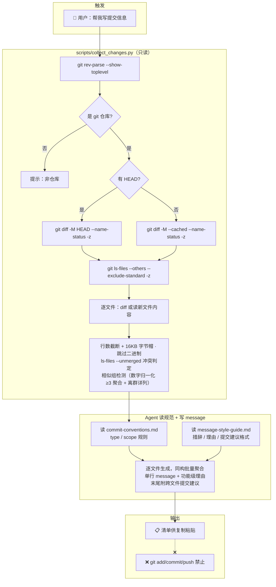

<div align="center">

# 📝 Commit Message Assistant

**提交前为每个改动文件自动生成可粘贴的 Conventional Commits 提交信息，并给出跨文件提交分组建议**

*Read-only commit message generator · Commits only after your explicit approval · Never pushes*

[](https://www.python.org/)
[](https://git-scm.com/)
[](https://conventionalcommits.org/)

[快速开始](#-快速开始) · [工作原理](#️-工作原理) · [核心亮点](#-核心亮点) · [项目结构](#-项目结构)

</div>

---

> 它不替你提交，只把"该怎么写"摆好让你复制粘贴。

Commit Message Assistant 是一个 ZCode 技能，在你 `git commit` 之前，自动为每个有改动的文件生成一条可以直接粘贴的 Conventional Commits 单行 message 和一行功能级理由；同构批量文件（如脚本切出的多年份 JSON）自动聚合为一条，不逐份凑数；清单末尾还会附上跨文件提交分组建议，告诉你哪些文件适合同一次提交。默认只产文本；当你明确审批（"已经仔细审批了，帮用户提交吧" + 点名目标）后，它也会代你执行分组提交——本地 add + commit，push 永远留给你。

你只管改代码，提交信息交给它。**全程只读，绝不碰 `git add / commit / push`。**

## 🏗️ 工作原理



## ✨ 核心亮点

| 亮点                     | 说明                                                                     | 落点                                         |
| ------------------------ | ------------------------------------------------------------------------ | -------------------------------------------- |
| **只读安全**             | 全程仅调 `rev-parse` / `diff` / `ls-files`，严禁任何写操作               | `collect_changes.py` 全部 git 调用           |
| **逐文件输出**           | 每个改动文件一条单行 message + 一行功能级理由，直接复制粘贴              | SKILL.md Workflow §5                         |
| **相似文件聚合**         | 同构批量文件（如年份切割的几十个 JSON）识别为一组，聚合为一条 message，代表详列、离群转详列、其余略 | `collect_changes.py` find_similar_groups     |
| **字节帽防大文件**       | 行数截断之外再加 16KB 字节帽，单行压缩 JSON / minified JS 不会撑爆上下文 | `collect_changes.py` trunc_bytes             |
| **跨文件提交建议**       | 清单末尾按"同一逻辑变更"给出提交分组建议 + 合并 message，切提交不再靠猜  | SKILL.md Workflow §6 + message-style-guide   |
| **冲突权威判定**         | `ls-files --unmerged` 枚举冲突文件（`diff HEAD` 会把冲突伪装成普通修改） | `collect_changes.py` collect                 |
| **Conventional Commits** | type 英文前缀 + 中文正文，scope 按目录自动推断、拿不准就省略             | `references/commit-conventions.md`           |
| **全类型覆盖**           | 新增 / 修改 / 删除 / 改名 / 合并冲突，按类型分组、组内字母序             | `collect_changes.py` parse_name_status       |
| **全新仓库支持**         | 无 HEAD 时自动 fallback 到 `git diff --cached`，staged 文件不丢失        | `collect_changes.py` collect                 |
| **子目录调用支持**       | 传仓库子目录时自动定位仓库根，路径语义与仓库根调用一致                   | `collect_changes.py` collect（--show-toplevel） |
| **大文件 & 二进制**      | diff > 200 行截断前 80 行；新文件 > 300 行截断；二进制先读 8192 字节判定 | `collect_changes.py` trunc_lines / is_binary |
| **删除文件轻量处理**     | 删除文件只输出文件名与 HEAD 中行数，不输出冗长全量 diff                  | `collect_changes.py` head_line_count         |

## 🚀 快速开始

### 0️⃣ 环境要求

| 组件                                                              | 版本  | 用途                                  |
| ----------------------------------------------------------------- | ----- | ------------------------------------- |
| Python                                                            | 3.10+ | 运行采集脚本                          |
| Git                                                               | 2.33+ | 读取仓库改动（只读）                  |
| Claude Code / Codex / Cursor / OpenClaw / Gemini CLI 等，任选其一 | 最新  | Skill 本体是 Markdown，运行时负责执行 |

> 跑自检（`tests/selftest.sh`）需要 bash 环境：Windows 请安装 Git Bash（Git for Windows 自带），macOS / Linux 自带。

### 1️⃣ 安装

打开你正在用的 agent，直接告诉它：

```
帮我安装这个 skill：https://github.com/WeatherCore/Commit-Message-Assistant
```

### 2️⃣ 触发

在有未提交改动的 git 仓库目录下，对 Agent 运行时 说：

```
帮我写提交信息
```

或任意同义表述：`commit message` / `这些改动怎么写提交` / `帮我生成提交备注`。

### 3️⃣ 复制粘贴

技能输出逐文件清单，每条格式：

```
### src/auth/login.py
feat(auth): 增加邮箱登录
*理由：新增邮箱登录后端校验与查重逻辑，供 /login/email 接口使用。*
```

复制第二行（message 行）到你的 `git commit -m "..."` 即可，理由行供你判断和微改，不进 commit。

### 4️⃣ 切换规范（可选）

| 你说的话   | 效果                         |
| ---------- | ---------------------------- |
| *（默认）* | type 英文 + 正文中文         |
| 用英文     | type 与正文都用英文          |
| 自由格式   | 不加 type 前缀，直接中文描述 |

### 5️⃣ 审批后代为提交（可选）

清单核对无误后，你可以说：

```
我已经仔细审批了，帮用户提交吧，按提交建议 1 和 3 执行
```

技能会逐组执行 `git add <点名路径>` → 暂存集核对 → `git commit -m "<该组合并 message>"`，并报告每组 hash 与剩余文件。边界：

| 允许（审批后）             | 永久禁止                     |
| -------------------------- | ---------------------------- |
| `git add <显式路径>`       | `git add -A` / `git add .`   |
| `git commit -m "<message>"` | `git commit --no-verify`     |
| 逐组串行、失败即停         | `git push` / `git tag` / `--amend` |

未满足双要件（无审批语义或未点名目标）→ 不猜，回清单请你确认；push 无论怎么问都是手动。

## 📦 项目结构

```
commit-message-assistant/
├── 📄 SKILL.md                   # 技能入口：触发、工作流、约束、校验
├── 📂 scripts/
│   └── 🔧 collect_changes.py     # 只读采集：改动文件列表 + diff/内容，截断、二进制与相似组处理
├── 📂 references/
│   ├── 📖 commit-conventions.md   # Conventional Commits type 列表 + scope 规则
│   └── 📖 message-style-guide.md # 单行 message 措辞、多变更折叠、相似组聚合、理由写法
├── 📂 examples/
│   └── 📄 sample-output.md       # 四种典型场景的示例输出
└── 📂 tests/
    └── 🧪 selftest.sh            # 自检：临时仓库覆盖各改动类型 + 相似组 + 字节帽 + 子目录 + 冲突 + 只读性断言
```

逐文件深度说明见 [SKILL.md](SKILL.md)，示例输出见 [examples/sample-output.md](examples/sample-output.md)。

<details><summary><b>🔧 可调参数</b>（点击展开）</summary>

`collect_changes.py` 顶部的阈值常量可根据项目规模调整：

| 常量                   | 默认值 | 含义                               |
| ---------------------- | ------ | ---------------------------------- |
| `LARGE_DIFF_LINES`     | 200    | tracked 文件 diff 超过此行数则截断 |
| `KEEP_DIFF_LINES`      | 80     | 截断后保留的前 N 行                |
| `UNTRACKED_FULL_LINES` | 300    | 新文件行数 ≤ 此值则读全文          |
| `KEEP_UNTRACKED_LINES` | 80     | 新文件截断后保留的前 N 行          |
| `MAX_BODY_BYTES`       | 16384  | 文件体（diff/新文件内容）字节上限，防单行超大文件 |
| `MANY_FILES`           | 50     | 改动文件超过此数则顶部加提醒       |
| `SIMILAR_GROUP_MIN`    | 3      | 同模式文件达到此数则标记相似组     |

</details>

## 🛡️ 安全约束

这是本技能的**最高优先级规则**。默认只读，仅在你明确审批后才代为提交（本地 add + commit）：

| 默认允许（只读）         | 审批后允许                   | 永久禁止（任何情况）         |
| ------------------------ | ---------------------------- | ---------------------------- |
| `git status`             | `git add <显式路径>`         | `git add -A` / `git add .`   |
| `git diff`               | `git commit -m "<message>"`  | `git push`                   |
| `git diff --cached`      | 逐组串行、失败即停           | `git commit --no-verify`     |
| `git diff --name-status` |                              | `git merge` / `git rebase`   |
| `git log`                |                              | `git reset` / `git stash`    |
| `git show`               |                              | `git tag` / `--amend`        |
| `git ls-files`           |                              | `git checkout`               |
| `git rev-parse`          |                              |                              |

若你对技能说"直接提交/推上去"但未给出审批语义与明确目标，它不会执行任何写操作，只会重新生成清单请你确认；push 无论怎么问都需要你手动执行。

## 📜 更新日志

### v1.2.0
- **16KB 字节帽**：行数截断之外再加字节上限，单行压缩 JSON / minified JS 不再撑爆上下文
- **离群详列对称化**：相似组离群成员判据统一（>2× 或 <½ 代表），新增/修改/改名三组一致，离群成员转为详列
- **冲突权威判定**：改用 `ls-files --unmerged` 枚举冲突文件，修复 `diff HEAD` 把冲突伪装成普通修改的盲区
- **子目录调用**：传仓库子目录自动定位仓库根，路径语义统一
- **跨文件提交建议**：清单末尾新增 `💡 提交建议` 节，按同一逻辑变更给出提交分组 + 合并 message
- **审批后代为提交**：双要件（明确审批语义 + 点名目标）齐备后逐组 add + commit，暂存集核对、失败即停；push/tag/amend 永久禁止
- 自检扩展到 6 场景 22 断言（新增冲突 / 字节帽 / 修改组离群 / 子目录用例）

### v1.1.0
- 相似文件聚合：同构批量文件（年份切割 JSON 等）识别为一条 message，代表详列、其余略

### v1.0.0
- 首个版本：逐文件 Conventional Commits message + 功能级理由

## 🗺️ Roadmap

- [x] 逐文件 Conventional Commits message + 功能级理由
- [x] 按类型分组（新增→修改→删除→改名）+ 字母序
- [x] 大 diff / untracked 大文件截断
- [x] 二进制文件自动跳内容留文件名
- [x] 只读安全约束（grep 可验证）
- [x] 全新仓库支持（无 HEAD 时 fallback 到 --cached）
- [x] 合并冲突检测与提醒
- [x] 删除文件轻量处理（仅文件名+行数）
- [x] Windows 编码兼容
- [x] 相似文件聚合（同构批量文件识别为一条 message，v1.1.0）
- [x] 指定子目录生成（自动定位仓库根，v1.2.0）
- [x] 跨文件提交分组建议（v1.2.0）
- [x] 审批后代为提交（双要件豁免，v1.2.0）
- [ ] 支持输出 JSON 机器可读格式

---

<div align="center">

**觉得有用？给个 ⭐ Star 吧！**

</div>
